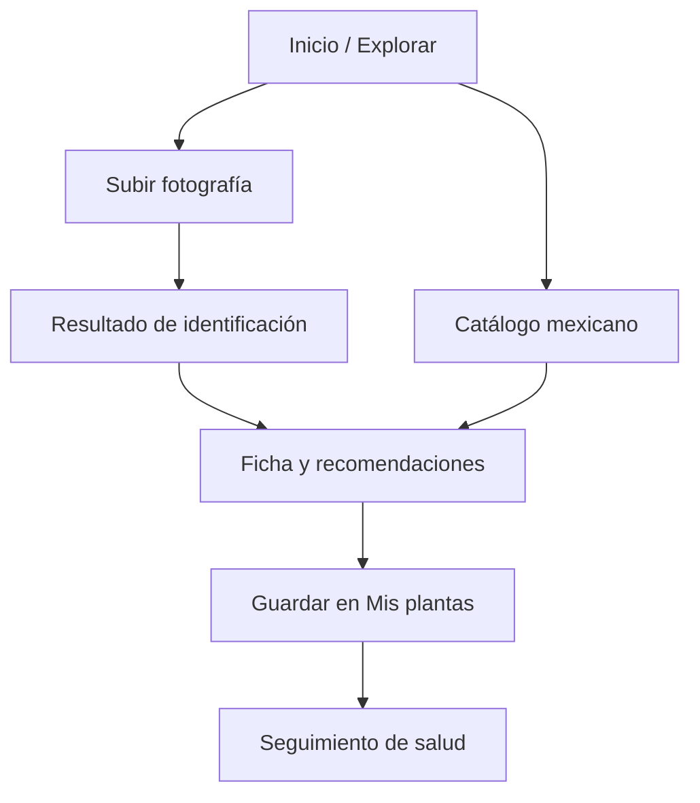
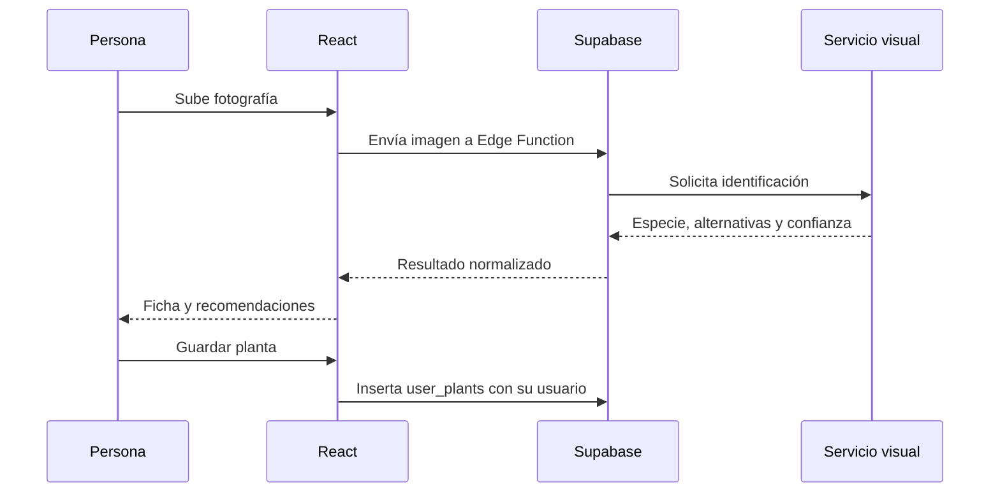

# Mapa de producto — Cultívame

## Propósito

Ayudar a una persona en México a reconocer una planta, entender sus cuidados y darle seguimiento en casa.

## North star

**De una foto a una planta cuidada.**

La identificación no es el producto completo: es la entrada a un ciclo de aprendizaje y cuidado.

## Journey principal

| Etapa | Necesidad de la persona | Experiencia | Resultado |
|---|---|---|---|
| Descubrir | “¿Qué es esta planta?” | Inicio y catálogo | Decide subir una foto |
| Identificar | “Quiero saber qué encontré” | Carga, vista previa y análisis | Especie probable + confianza |
| Entender | “¿Qué significa y cómo la cuido?” | Ficha de planta | Cuidados y recomendaciones |
| Guardar | “No quiero perder esta información” | Mis plantas | Planta asociada a su cuenta |
| Acompañar | “Quiero saber si está bien” | Estado, notas y revisiones | Viva / necesita cuidados / muerta |
| Aprender | “Quiero mejorar mi huerto” | Historial y contenido local | Hábitos y decisiones futuras |

## Mapa de pantallas



## Mapa técnico

| Capa | Responsabilidad | Primera versión |
|---|---|---|
| React + Vite | Interfaz, estados y journey | GitHub Pages |
| Supabase Edge Functions | Ocultar claves y coordinar servicios | `identify-plant` |
| Identificación | Especie probable y confianza | Pl@ntNet |
| Datos botánicos | Taxonomía y distribución | GBIF / iNaturalist |
| Recomendaciones | Cuidados para México | Catálogo editorial propio |
| Persistencia | Plantas, estados y notas | Supabase ya conectado |

## Contrato inicial de API

### `POST /api/identify`

Entrada:

```json
{
  "image": "multipart/form-data",
  "organ": "auto",
  "location": "Puebla, MX"
}
```

Salida:

```json
{
  "identificationId": "id",
  "plant": {
    "commonName": "Bugambilia",
    "scientificName": "Bougainvillea glabra"
  },
  "confidence": 0.86,
  "alternatives": [],
  "recommendations": [],
  "source": "plantnet"
}
```

## Modelo de datos inicial

- `plants`: especie, nombres comunes, categoría, descripción y cuidados.
- `recommendations`: acción, frecuencia, temporada, fuente y revisión editorial.
- `identifications`: fecha, especie, confianza y fuente; no guardar foto por defecto.
- `user_plants`: usuario, planta, estado, fecha de alta y última revisión.
- `care_logs`: estado, nota, fecha y cambio observado.

## Alcance del MVP

### Incluido

- Catálogo inicial de especies mexicanas.
- Carga y vista previa de imagen.
- Identificación conectada a un endpoint seguro.
- Confianza y alternativas.
- Recomendaciones editoriales.
- Guardar plantas.
- Estado de salud y notas básicas.

### Después del MVP

- Login con Google.
- Sincronización entre dispositivos.
- Recordatorios de riego.
- Historial fotográfico.
- Alertas fitosanitarias y noticias.
- Identificación de enfermedades.

## Métricas de validación

- Porcentaje de personas que completan una identificación.
- Tiempo desde “subir foto” hasta “ver resultado”.
- Porcentaje que guarda la planta.
- Porcentaje que vuelve a revisar una planta.
- Identificaciones con confianza baja.
- Errores o correcciones reportadas por la comunidad.

## Estado del backend

Supabase ya está conectado al proyecto. No necesitamos crear otra infraestructura. El siguiente trabajo consiste en auditar y completar la conexión existente:

1. Confirmar el proyecto, variables públicas y cliente de Supabase.
2. Revisar las tablas, relaciones y políticas RLS actuales.
3. Crear o completar la Edge Function `identify-plant`.
4. Guardar identificaciones, confianza y recomendaciones.
5. Conectar `Mis plantas` a Supabase en lugar de depender solo de `localStorage`.
6. Añadir autenticación cuando el flujo principal esté validado.

## Decisiones pendientes

1. Confirmar qué proveedor de identificación se conectará desde Supabase: Pl@ntNet u otro.
2. Definir las primeras 30–50 plantas mexicanas.
3. Decidir qué recomendaciones requieren revisión de una fuente experta.
4. Definir cuándo migramos el guardado local a cuentas sincronizadas.

## Fase final de definición antes de construir

### 1. Mapa de navegación

| Ruta | Acceso | Objetivo |
|---|---|---|
| `/` | Público | Presentar Cultívame y comenzar una identificación |
| `/explorar` | Público | Buscar y filtrar plantas mexicanas |
| `/identificar` | Público | Subir una foto y recibir un resultado |
| `/planta/:id` | Público | Consultar ficha, cuidados y recomendaciones |
| `/mis-plantas` | Usuario autenticado | Ver únicamente las plantas propias |
| `/mis-plantas/:id` | Usuario autenticado | Registrar estado, notas y revisiones |
| `/cuenta` | Usuario autenticado | Gestionar sesión y preferencias |

### 2. Regla de propiedad

El catálogo botánico es público. Todo lo que una persona agrega o registra es privado y pertenece a `auth.uid()`:

```txt
user_plants.user_id = auth.uid()
identifications.user_id = auth.uid()
care_logs.user_id = auth.uid()
```

La interfaz no decide qué datos puede ver una persona: esa protección vive en las políticas RLS de Supabase.

### 3. Flujo de identificación



### 4. Orden de construcción

1. Confirmar conexión actual de Supabase y variables de entorno.
2. Confirmar o crear Auth y el flujo de inicio de sesión.
3. Revisar tablas existentes y agregar `user_id` donde falte.
4. Aplicar políticas RLS y probar aislamiento entre dos usuarios.
5. Conectar `Mis plantas` a Supabase; dejar `localStorage` solo como fallback temporal.
6. Crear la Edge Function de identificación.
7. Conectar recomendaciones y fuentes editoriales.
8. Probar el journey completo con datos de prueba.
9. Publicar una versión de prueba y medir el uso.

### 5. Pruebas mínimas de aceptación

- Una persona puede identificar una planta sin iniciar sesión.
- Se solicita sesión solo al guardar o dar seguimiento.
- Dos usuarios no pueden ver las plantas del otro.
- Una persona puede cambiar el estado de su planta.
- Cerrar sesión elimina el acceso a `Mis plantas`.
- La identificación muestra confianza y alternativas.
- Una falla del proveedor no rompe el catálogo.
